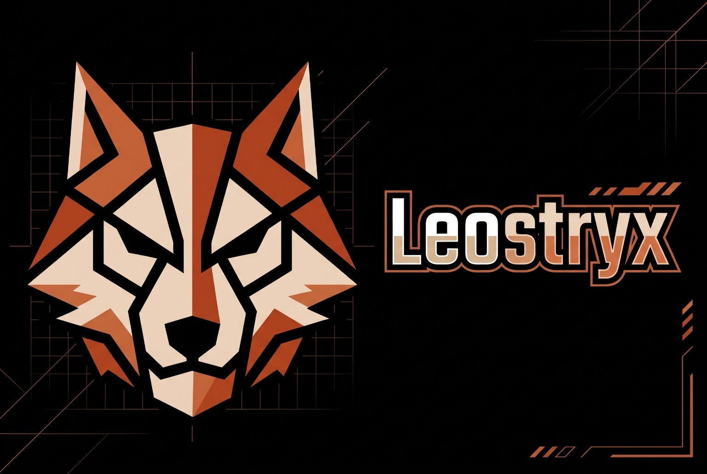

<p align="center"></p>

# Leostryx для Android

Откройте проект на телефоне и опишите задачу в чате. Leostryx работает на базе Antigravity: агент может изменить код, запустить команду в терминале и собрать приложение прямо на Android. Выберите Gemini или подключите своего ИИ-провайдера.

**Стабильный релиз · 3.2 · сборка 47**<br>
Android 8.0 и выше · ARM64

- **[Скачать Standard APK][standard]** — основной вариант для Gemini и пользовательских провайдеров.
- **[Скачать Bypass APK][bypass]** — вариант с изменённой региональной проверкой Gemini.

[Страница релиза][release] · [Контрольные суммы SHA-256][sums] · [Telegram][telegram]

## Интерфейс

Слева — проекты и чаты, справа — выбор модели. Коснитесь снимка, чтобы рассмотреть детали.

<a href="assets/screenshots/home.jpg"></a>
<a href="assets/screenshots/models.jpg"></a>

<details>
<summary>Щит, диктовка и темы оформления</summary>

**Разрешения агента и голосовой ввод**

<a href="assets/screenshots/shield.jpg"></a>
<a href="assets/screenshots/dictation.jpg"></a>

**Тёмная и светлая темы**

<a href="assets/screenshots/dark-theme.jpg"></a>
<a href="assets/screenshots/light-theme.jpg"></a>

</details>

## Что нового в 3.2

- **HTML прямо в чате.** Интерактивную страницу можно открыть из сообщения или карточки файла. Предпросмотр работает с Gemini и пользовательскими провайдерами.
- **Обновление ответа и ветки.** «Обновить» повторяет исходный вопрос с вложениями. Если выбрать более ранний ответ, продолжение диалога сохранится. «Новая ветка» переносит контекст в отдельный чат того же проекта.
- **Команды у всех провайдеров.** При переходе с Gemini на пользовательского провайдера в «+» → «Добавить контекст» доступны те же команды, включая «Действия» и «Браузер». В окне `/` переведены описания четырёх команд MCP Everything.
- **Текст и оформление.** В настройках можно менять яркость, размер и начертание шрифта. Палитра открывается слева от группы цветов. Выпадающие списки учитывают тему, а меню уровня мышления и предустановки совпадают по ширине со своими кнопками.
- **Контекст и соединение.** Круг контекста показывает токены ввода и вывода, возможности модели и команду ручного сжатия. При обрыве связи приложение показывает состояние переподключения.

[Все изменения сборки 47][release] · [История версий](CHANGELOG.md)

## Установка и обновление

1. Скачайте один из двух APK выше. Для сторонних провайдеров подойдёт Standard.
2. Откройте файл на телефоне и подтвердите установку. Если Android запросит разрешение, разрешите установку для приложения, из которого открыли APK.
3. При обновлении Leostryx 3.x с тем же пакетом `com.agyru.t2` и той же подписью установите APK поверх текущей версии. Для перехода со старой сборки с другой подписью сначала сохраните нужные данные.

## Возможности

- **Модели и чат.** Gemini, пользовательские API, вложения, ветвление диалогов и сжатие контекста. Поддержка изображений, аудио, видео и вызова инструментов зависит от модели и провайдера.
- **Агенты и инструменты.** Субагенты доступны через `@` и меню действий. Возможности агента можно расширять плагинами и MCP-серверами. Для разработки есть терминал, logcat, инструменты Gradle и установка Flutter SDK.
- **Разрешения.** В меню «Щит» задаются профиль безопасности, доступ к файлам и сети, правила запуска терминала и выполнения JavaScript в браузере.
- **Оформление.** Светлая, тёмная и пользовательские темы, настройка шрифтов и цветов. Для значка приложения доступны волк, медведь, рысь и сова.
- **Интеграция с Android.** Голосовой ввод с офлайн-распознаванием Vosk, уведомления о задачах, открытие файлов проекта в проводнике и просмотр локального видео.

<details>
<summary><strong>Исходники и сборка</strong></summary>

[Архив исходников релиза][source]. Для сборки из рабочего дерева репозитория используются Python 3 и OpenJDK 17. Из корня проекта выполните:

```sh
python3 rebuild.py both
```

Для одного варианта передайте `standard` или `bypass`. Сборщик помещает подписанные APK в `dist/signed/`. Логика упаковки и подписи описана в [rebuild.py](rebuild.py).

</details>

<details>
<summary><strong>English overview</strong></summary>

Leostryx is an Android build of Antigravity for working with an AI coding agent on your phone. Open a project, choose a provider and use the chat to edit files or run commands.

**Stable release 3.2, build 47** requires Android 8.0 or later on ARM64. Download [Standard][standard] for the default core or [Bypass][bypass] for the alternative Gemini region check. This release adds interactive HTML previews for custom providers, project branches and Russian descriptions for MCP Everything commands. See the [release notes][release] for details.

</details>

## Проект и лицензия

Leostryx основан на [Antigravity для Android](https://github.com/werdio325-png/antigravity-android). Сборку поддерживает [Leostrange](https://github.com/Leostrange). Код проекта распространяется по [Apache License 2.0](LICENSE). Для сторонних компонентов действуют лицензии их авторов.

[standard]: https://github.com/Leostrange/Leostryx/releases/download/v3.2/Leostryx-3.2-standard.apk
[bypass]: https://github.com/Leostrange/Leostryx/releases/download/v3.2/Leostryx-3.2-bypass.apk
[release]: https://github.com/Leostrange/Leostryx/releases/tag/v3.2
[sums]: https://github.com/Leostrange/Leostryx/releases/download/v3.2/SHA256SUMS-3.2.txt
[source]: https://github.com/Leostrange/Leostryx/releases/download/v3.2/Leostryx-repo.zip
[telegram]: https://t.me/+qji9jQ68cWRmZDky
