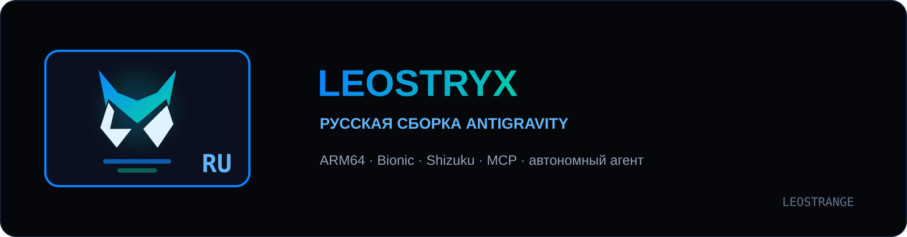

<p align="center"></p>

<p align="center">
  <a href="https://github.com/Leostrange/Leostryx/releases/latest"></a>
  
  
  
  <a href="LICENSE"></a>
</p>

<p align="center"><b>Leostryx для Android — русская сборка Antigravity (v3.0.7).</b><br/>
Полная русификация, щит безопасности агента, вкладка субагентов, уведомления в шторке с прямым ответом, оптимизация памяти, темы и компактный интерфейс, смена иконки и цвета на лету, вложения, Flutter SDK, MCP- и UTCP-серверы.</p>

<p align="center"><sub>Форк <a href="https://github.com/werdio325-png/antigravity-android">werdio325-png/antigravity-android</a> — сборка <a href="https://github.com/Leostrange">@Leostrange</a>.</sub></p>

<p align="center"><a href="https://github.com/Leostrange/Leostryx/releases/tag/v3.0.7"><b>Скачать APK</b></a> &nbsp;·&nbsp; <a href="https://github.com/Leostrange/Leostryx/releases/tag/v3.0.7">Исходный код</a> &nbsp;·&nbsp; <a href="CHANGELOG.md">Изменения</a> &nbsp;·&nbsp; <a href="https://github.com/Leostrange/Leostryx/issues">Issues</a></p>

---

## Leostryx для Android 3.0.7

**Antigravity** — автономный агентный движок разработки, который работает **нативно в userspace Android** (Linux 6.1, AArch64, Bionic) внутри процесса приложения — без PRoot, QEMU и chroot. Агент на моделях Gemini сам осматривает кодовую базу, правит файлы, запускает сборку и проверяет результат прямо на устройстве.

**Leostryx** — русская сборка этого окружения с доработанным интерфейсом и настройками автономной работы агента. Сделана **на основе [werdio325-png/antigravity-android](https://github.com/werdio325-png/antigravity-android)** — этот репозиторий является его форком.

## Возможности

- **полная русификация** интерфейса: словарь EN → RU, статусы действий агента, живой индикатор рассуждений, русская плюрализация, полный перевод раздела «Бэкап»;
- **субагенты (Subagents)**: вкладка субагентов в кастомизации, готовый каталог (Code Reviewer, Android Debugger, Security Auditor и др.), создание и вызов субагентов в чате, fallback-роутинг моделей в AgyGateway;
- **уведомления в шторке Android**: интерактивные уведомления с кнопкой прямого ответа (`RemoteInput`) и быстрого подтверждения «Разрешить / Продолжить»;
- **оптимизация энергопотребления и RAM**: отключение предрастеризации WebView, возврат страниц RAM ядром Go (`madvdontneed=1`, `GOMEMLIMIT=384MiB`), выгрузка моделей Vosk и очистка памяти при нехватке;
- **темы и frosted glass**: адаптация селектора моделей и всех выпадающих списков/попапов к тёмной и светлой теме с истинной прозрачностью и размытием;
- **плавность и быстродействие**: мгновенное открытие проводника медиа/файлов без чёрных экранов, плавное опускание чата при скрытии клавиатуры;
- **щит безопасности** в чате: профиль безопасности, доступ к файлам и интернету, автовыполнение команд терминала, песочница и JavaScript — с реально сохраняющимися выборами;
- **автономный режим агента**: «Не спрашивать» (EAGER) — агент работает без лишних подтверждений;
- **компактный чат** с вложениями до 10 файлов (просмотр и удаление прикреплённого);
- настройки диктовки, режимы мышления, экспорт сессий (Markdown, PDF и изображения);
- **консоль приложения** (Tools → Консоль) для снятия логов: отдельные запуски команд, кнопки копирования и очистки, быстрый `logcat`;
- **история ошибок** с фильтром реальных сбоев, прокруткой и кнопкой «Копировать всё»;
- встроенные инструменты разработки (Tools) и бэкенд настроек с поддержкой **Flutter SDK в 1 клик**;
- **MCP-серверы** (sequential-thinking, exa, github-mcp-server, StitchMCP) — в том числе с кастомными провайдерами;
- **UTCP-серверы и OpenAPI 3.0** (Universal Tool Calling Protocol) — прямое подключение REST API и спецификаций без написания промежуточных прокси;
- **кастомизация агента**: навыки (Skills), субагенты (Subagents), каталог плагинов из Build With Google;
- **кастомизация иконок, логотипа и акцентного цвета на лету**: 4 набора значков (Сова, Рысь, LSX, Angular X) с мгновенным переключением иконки на рабочем столе (через `activity-alias`), динамическая перекраска логотипа в шапке и на экране входа, сплэш-скрина и акцентного цвета кнопок.

## Сборки

| Сборка | Назначение | Файл |
|---|---|---|
| **Standard** | базовая, без обхода региональных ограничений | [`Leostryx-3.0.7-standard.apk`](https://github.com/Leostrange/Leostryx/releases/tag/v3.0.7) |
| **Bypass** | с обходом региональных ограничений (region bypass) | [`Leostryx-3.0.7-bypass.apk`](https://github.com/Leostrange/Leostryx/releases/tag/v3.0.7) |

Region bypass — патч Go-ядра `liblanguage_server.so`: в трёх местах байтовые проверки заменены на запись константы `1` (форс-пропуск), плюс обновляется `assets/runtime/manifest.json` с sha256 ядра. В standard-сборке стоят оригинальные инструкции, в bypass — патченые. Дельта лежит отдельно в `variants/bypass/`.

## Установка

> [!WARNING]
> **Чистая установка (только с нуля):** Сборка 3.0+ **не устанавливается поверх** старых версий 2.x (возникает ошибка «Приложение не установлено, так как оно конфликтует с другим пакетом» из-за обновления пакета `com.agyru.t2` и ключа подписи). Поверх версий 3.0.x (`com.agyru.t2`) обновление встаёт штатно без удаления.

1. Скачайте APK из [релиза v3.0.7](https://github.com/Leostrange/Leostryx/releases/tag/v3.0.7) и сверьте SHA-256 с файлом [`SHA256SUMS.txt`](https://github.com/Leostrange/Leostryx/releases/download/v3.0.7/SHA256SUMS.txt).
2. Установите скачанный APK 3.0.7 (`standard` или `bypass`) и запустите приложение.

## Что нового в 3.0.7

- **адаптация селектора выбора моделей к темам и прозрачности** — панель выбора модели теперь оформлена в стиле матового стекла (frosted glass) с `backdrop-filter: blur(22px) saturate(190%)` и плавно вписывается как в тёмную, так и в светлую тему;
- **истинная прозрачность выпадающих списков и попапов в светлой теме** — убраны непрозрачные белые подложки внутри всплывающих списков, контекстных меню и Radix Popper контейнеров;
- **мгновенное и плавное открытие проводника файлов (+ / Медиа)** — устранён посредник `Intent.createChooser`, убраны рывки, полоса сбоку и чёрный экран при вызове выбора файлов;
- **плавное опускание чата при скрытии клавиатуры** — устранена задержка и цветной заполнитель на месте закрывающейся клавиатуры за счёт мгновенной синхронизации `100%` высоты и отключения задержек `nudgeSeries`.

## Что нового в 3.0.6

- **субагенты (Subagents) и каталог в 1 клик** — полноценное управление субагентами в настройках кастомизации, готовые пресеты, вызов в чате и fallback-роутинг моделей в шлюзе `AgyGateway`;
- **уведомления агента в шторке Android с прямым ответом** — канал `agy_agent_chat`, поле ввода `RemoteInput` («Ответить») и кнопка быстрого подтверждения «Разрешить / Продолжить»;
- **оптимизация энергопотребления, памяти и нагрева** — отключение избыточного предрастерирования WebView, освобождение памяти Go через `madvdontneed=1` / `GOMEMLIMIT=384MiB`, очистка памяти при сворачивании и выгрузка моделей Vosk;
- **фирменный баннер с рысью (Lynx)** в `assets/leostryx-banner.svg` в стилистике логотипа;
- **устранение сброса на Gemini 4 Argon** — фиксация выбранной пользователем модели (включая Gemini 3.8 Flash) без фонового переключения;
- **динамическая перекраска иконок и логотипа** при смене акцентного цвета в оформлении;
- **расширение лимитов нативного моста AgyTools** до 64 КБ с поддержкой спецсимволов `|` и `#`.

## Что нового в 3.0.5

- **смена иконки на рабочем столе на лету (без пересборки APK)** — 4 `activity-alias` (`IconPack1Activity`..`IconPack4Activity`) и нативный мост `IconPackSwitcher`;
- **живой SVG-логотип и динамический акцентный цвет** — выбор логотипа и цвета в «Настройки › Оформление» мгновенно перекрашивает логотип на экране входа, в шапке, в превью настроек и все акцентные кнопки (`--primary`);
- **экран входа «Добро пожаловать в Leostryx»** и полный перевод раздела резервного копирования («Бэкап»);
- **непрерывная работа в фоне и долгих задач** — отключён ложный 120-секундный сторож `AGY-P2-16` на канале `StreamCascadeReactiveUpdates`, а также отключена заморозка таймеров и памяти WebView при сворачивании приложения;
- **чистый старт без мелькания экрана диагностики** и автоочистка манифестов плагинов (`plugin.json`);
- **разделители провайдеров в селекторе моделей** — модели из разных провайдеров (OpenAI, Anthropic, Gemini) сгруппированы с заголовками;
- **проверка отображения всех выбранных моделей** — все модели из настроек провайдеров корректно появляются в селекторе;
- **папка бэкапа: Leostryx Backup**, рабочая папка: **Leostryx Projects** (в интерфейсе и путях по умолчанию);
- проект переименован в Leostryx (репозиторий: `Leostrange/Leostryx`);
- новый баннер и брендинг в стиле Leostryx (цвет `#0b84ff`, маскот — рысь);
- по умолчанию стоит значок и лого в виде рыси (pack `02_lynx`);
- кастомизация иконок и splash screen добавлена в оформление: 4 набора (Сова, Рысь, LSX, Angular X), переключение в настройках;
- Pillow (PIL) интегрирован в приложение — доступен в билде после сборки;
- иконки в SVG загружены в архиве `Leostryx-4-SVG-logos.7z`;
- переход на собственную мажорную нумерацию **3.0**;
- интеграция **Flutter SDK** в «Настройки › Инструменты» (установка и удаление в 1 клик, bionic-патчинг `agy-fix-flutter`, верификация `flutter,dart`);
- реализация поддержки **UTCP-серверов и спецификаций OpenAPI 3.0** (вкладка «🌐 UTCP & OpenAPI», каталог готовых бесплатных API, мост в ядро);
- обновлённый раздел **«Пользовательские настройки»**: просмотр, клонирование и редактирование навыков (Skills), каталог плагинов из Build With Google;
- курация каталогов MCP и плагинов исключительно под нативные возможности Android (SQLite, Python, Node, Git);
- решение системных проблем JVM (Termux-OpenJDK) через глобальный профиль `65-agy-jvm.sh` (`JAVA_TOOL_OPTIONS`);
- новая обёртка `jadx-agy` с защитой от переполнения памяти (OOM-kill 137);
- устранение критического сбоя `JSONDecodeError` при сохранении ключей и переключении MCP-серверов при пустом `mcp_config.json`;
- автоматическое маскирование звёздочками (`***`) для всех секретных ключей (включая `X-Goog-Api-Key` для StitchMCP);
- исправление официальной ссылки StitchMCP на `https://stitch.withgoogle.com/` и автогенерация валидной конфигурации запуска;
- исправлена работа **MCP-серверов с кастомными провайдерами** (рекурсия shell-мостов, линковка Bionic, точки входа) — все 45 инструментов в статусе ready;
- устранено аварийное завершение процессов ядра и команд с кодом 164 (`SIGRTMIN+2` / signal 36 от Android 16 `traced_perf`);
- надёжное сохранение выбранной кастомной модели в `localStorage` при сворачивании и перезапуске приложения;
- устранено зависание установщика инструментов (Settings › Tools), добавлен автотайм-аут и кнопка отмены `[✕]`;
- исправлен запуск терминала (`libandroid-support.so not found`) через защищённую Bionic-обёртку bash с автоматическим экспортом `LD_LIBRARY_PATH`;
- **консоль приложения** (Tools → Консоль): команды выполняются отдельным запуском без PTY-сессии, тулбар с копированием и очисткой, кнопка `logcat`;
- **история ошибок**: показывает только реальные сбои (rc ≠ 0 или `@@fail`), успешные установки с текстом «error» в лицензиях больше не засоряют журнал;
- **прокрутка окна ошибок и терминала**: свой видимый ползунок, позиция сохраняется при догрузке, фоновая прокрутка чата заблокирована под модальным окном;
- **PDF-экспорт сессий** через `pymupdf` — без пустого системного принтера;
- **узкое меню сортировки диалогов** — ширина по содержимому, не перекрывает название диалога;
- подтверждение обновления пакетов: предпоказ числа и объёма перед `pkg upgrade`;
- защита потока чата: сторож зависшего соединения сужен до URL генерации.

Полный список: [CHANGELOG.md](CHANGELOG.md).

## MCP-серверы

- **Требуется Node.js**: `pkg install nodejs-lts`.
- **Процедура**: серверы добавляются из стандартного провайдера Antigravity, затем переключается ядро.
- **Шаблон конфига** — [`mcp_config.example.json`](mcp_config.example.json): каждый сервер запускается через `node <entrypoint.js>` с обязательными `LD_LIBRARY_PATH=$PREFIX/lib`, `PATH` и `NODE_PATH` в блоке `env`. Рабочий конфиг кладётся в `~/.gemini/config/mcp_config.json`.
- Проверено: `sequential-thinking`, `exa`, `github-mcp-server`, `StitchMCP` (mcp-remote) — суммарно 45 инструментов в статусе `MCP_SERVER_STATUS_READY`; вызовы пробрасываются шлюзом `AgyGateway` в кастомные модели по протоколу OpenAI.

## Ограничения ядра

1. **Стандартные и кастомные модели нельзя использовать одновременно.** Встроенные модели (Gemini / Claude / ChatGPT) и кастомные модели (провайдеры) работают только по отдельности — между ними переключается ядро.
2. **Плагины и MCP-серверы** в настройках пользователя также доступны только при переключённом ядре.
3. **Кастомные модели работают только с Android Speech Cognition** (транскрибация речи через микрофон) — встроенная голосовая цепочка им недоступна, это ограничение ядра.

## Состав репозитория (полный исходный код)

```text
├── README.md, CHANGELOG.md, LICENSE
├── assets/leostryx-banner.svg       баннер проекта (стилистика Leostryx)
├── app/                                   ПОЛНОЕ дерево APK без подписи
│   ├── AndroidManifest.xml, classes*.dex, resources.arsc, res/
│   └── assets/
│       ├── web/                           веб-интерфейс и мод (то, что правится)
│       │   ├── generated/main.js          бандл React-приложения
│       │   ├── agy_ru.css, agy_shield.js, agy_i18n.js, agy_tools.* …
│       │   ├── brand/                     кастомизация иконок и splash
│       │   │   ├── config.json            текущий пак (02_lynx по умолчанию)
│       │   │   ├── 01_owl/                пак «Сова»
│       │   │   ├── 02_lynx/               пак «Рысь» (по умолчанию)
│       │   │   ├── 03_lsx/                пак «LSX»
│       │   │   ├── 04_angular_x/          пак «Angular X»
│       ├── runtime/                       Go-ядро (liblanguage_server.so) и рантайм
│       └── env/                           bootstrap userspace, оверлей и пакеты
├── variants/bypass/                       дельта bypass-билда (manifest + патченое ядро)
├── rebuild.py                             скрипт сборки standard / bypass
├── compress-map.json                      файлы, хранимые в APK без сжатия
├── mcp_config.example.json                шаблон конфига MCP-серверов
├── tools/uber-apk-signer.jar              подпись + zipalign
├── tools/brand.py                         брендинг (иконки + label + dex strings)
└── dist/antigravity-signing.p12           ключ подписи (встаёт поверх установленного)
```

> [!NOTE]
> Полный архив исходников — [`Leostryx-repo.zip`](https://github.com/Leostrange/Leostryx/releases/tag/v3.0.7) в релизе. Два файла ядра `liblanguage_server.so` (по 181 МБ) не хранятся в git из-за лимита GitHub в 100 МБ на файл — они внутри APK и в архиве исходников.

## Сборка APK

Нужны Python 3 и Java (OpenJDK 17):

```bash
python3 rebuild.py            # оба APK (standard + bypass)
python3 rebuild.py standard   # только standard
python3 rebuild.py bypass     # только bypass
```

Готовые подписанные APK появятся в `dist/signed/`. Подпись — `dist/antigravity-signing.p12`, поэтому APK встаёт **поверх** установленного `com.agyru.bp` без потери данных.

Все правки интерфейса лежат в `app/assets/web/` — после изменений достаточно пересобрать.

## Лицензия

Код проекта распространяется по лицензии [Apache 2.0](LICENSE). Antigravity, Gemini и сторонние компоненты принадлежат соответствующим авторам и распространяются по их собственным лицензиям. Оригинальный проект: [werdio325-png/antigravity-android](https://github.com/werdio325-png/antigravity-android).

---

<p align="center"><sub>Part of the <a href="https://github.com/Leostrange">Leostrange</a> open-source projects.</sub></p>
